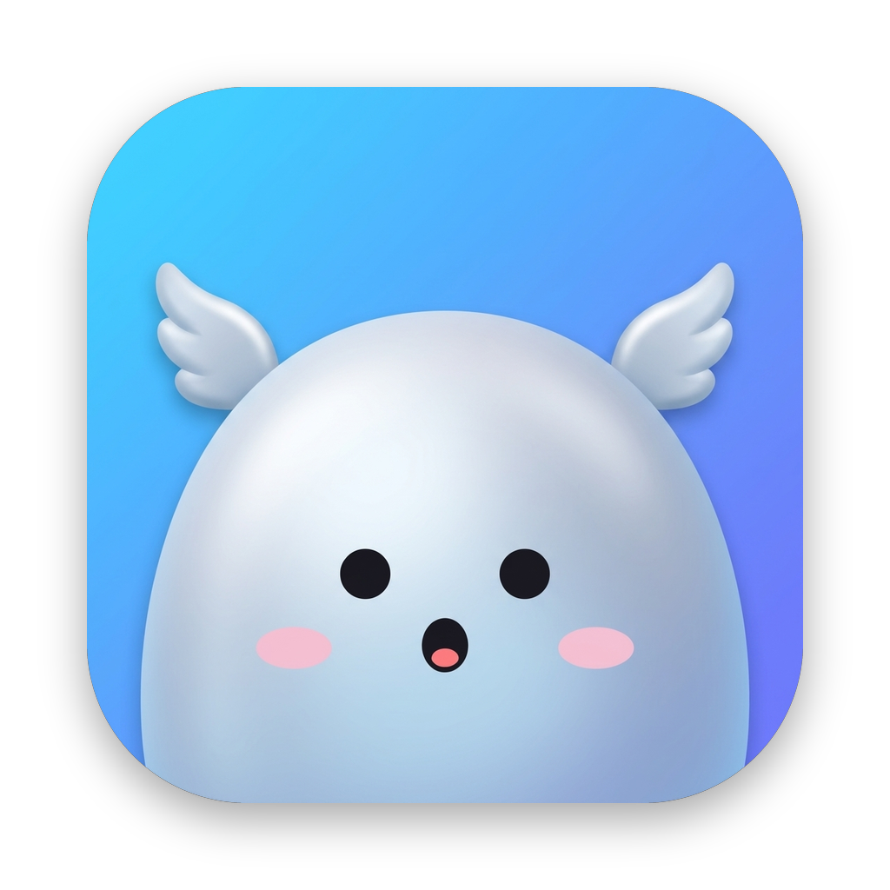
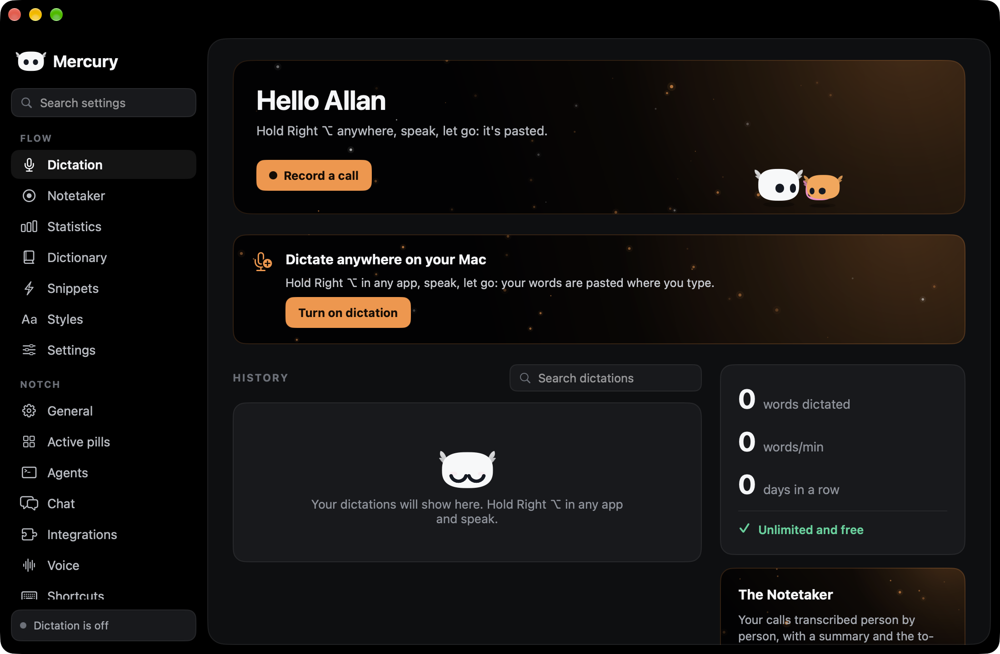
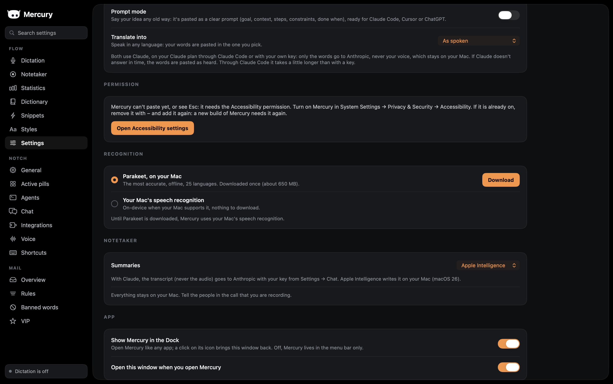

<div align="center">



# Mercury

**Named after the Roman messenger god — Mercury keeps watch on your AI coding agents and services, and reports back to you from your Mac's notch and your iPhone.**

Approve permissions, watch your agents work, drop a file, chat with Claude, dictate anywhere, or record calls — all without leaving what you're doing. Walk away from your Mac and Mercury follows you to your iPhone: Lock Screen, Dynamic Island, widgets, Siri.

[](https://github.com/allanindrajith/Mercury/releases)


</div>

---

## Why

**Mercury** is named after the Roman messenger god — swift, always watching, and always **reporting back to you**. Instead of tab-switching across terminals, editors, and dashboards to check if an agent finished, stalled, or needs approval, Mercury brings the message straight to your notch (or desktop island) and your phone.

Every line of code is open source under the MIT License: read it, fork it, learn from it.

Meet **Mercury**: a compact companion that lives in your notch, waves hello, follows your cursor, and reports back the moment Claude Code, Codex, Gemini CLI, or your services need you.

## Mercury on the Mac: dictation, notes, one window

<div align="center">

</div>

Since 0.4, Mercury has its own window and sits in the Dock. On the left, **Flow** — everything about your voice — and **Notch**, all the settings of the island. *(macOS, GitHub build)*

- 🎙️ **Flow dictation** — hold a key anywhere on the Mac (right ⌥ by default, or fn, right ⌘ or right ⌃), speak, let go: your words are pasted where you type, in any app. Two quick taps for hands-free (or one, with a setting), Esc to cancel, ⌃⌘V to paste the last one again. Your clipboard gets back what it held.
- 💊 **The pill** — a small see-through pill at the bottom of the screen (or on its left or right edge). Hover it for a toolbar: dictate, record a call, open Mercury. While you speak, Mercury listens and nine dots follow your voice.
- 🦜 **Parakeet, offline** — run NVIDIA's Parakeet on your Mac's Neural Engine through [FluidAudio](https://github.com/FluidInference/FluidAudio): more accurate, 25 languages, nothing leaves your Mac. One click to download (about 650 MB), Apple silicon only. Until then the Mac's own recognition is used.
- ✍️ **Your words, your way** — a dictionary of names Mercury always spells right, replacements, snippets (say a short phrase, paste a whole text), and an optional clean-up by Claude, on your Claude plan through Claude Code or with your own key: as said, natural or polished, per app.
- 📝 **Notetaker** — click Record a call: Mercury records your microphone and what your Mac plays, no bot joins the call. Then you get the transcript person by person, a summary, the key points and the to-dos, written by Claude with your key or by Apple Intelligence on your Mac. The audio is deleted once the transcript is written. Tell the people in the call that you record.
- 📊 **Statistics** — words dictated, time saved, words per minute, days in a row and the apps you dictate in. Counted on your Mac, never sent anywhere.

<table>
<tr>
<td width="33%"></td>
<td width="33%"></td>
<td width="33%"></td>
</tr>
</table>

Flow dictation and the Notetaker are on the Mac for now; Windows and Linux are next.

## Features

- 🤖 **Claude Code, Cursor, Codex, Gemini CLI, Antigravity, Copilot CLI, Muse Code, OpenCode, Amp, Hermes, Claude Desktop and other agents, live** — see every session in your notch: what it reads, edits and runs, step by step. Tag a hook payload with `mercury_agent` to give any agent its own pill (see [`docs/AGENTS.md`](docs/AGENTS.md)). Finished? Mercury does a happy little jump.
- See what Claude is editing, live in the notch: each file modification shows the file name and +N −M counts in the ticker, tap to read the full diff
- ✅ **Approve and answer from the notch** — Claude Code permission requests show up with **Allow / Deny / Always**; `AskUserQuestion` prompts show the choices right in the notch (single or multi-select, up to 4 questions). One click, or "Reply in terminal" to fall back to the CLI. Codex also gets Allow / Deny.
- 🧑‍💻 **Jump to the right terminal** — open the exact terminal window of a session *(macOS)*.
- 💬 **Chat with Claude, Gemini, OpenAI, DeepSeek, Qwen, Moonshot, or a local model (Ollama / LM Studio)** — click the model name above the chat box to switch provider and pick a model. Cloud providers use your own API key; local providers connect to a server running on your Mac. **No API key? Use your subscription**: switch it on in Settings → Chat and the chat goes through the official terminal tool you already pay for, signed in with your own account — Claude Code, Antigravity CLI or Gemini CLI, Codex CLI (ChatGPT), Cursor CLI or GitHub Copilot CLI *(GitHub build, Windows, Linux)*. *(Gemini, OpenAI, DeepSeek, Qwen, Moonshot and local models: macOS)*
- 📈 **Portfolio pill** *(macOS)* — track your crypto across 16 networks (Bitcoin, Ethereum, Solana, Polygon, BNB, Avalanche, Arbitrum, Optimism, Base, Dogecoin, Litecoin, TRON, XRP, Cardano, Cosmos, NEAR) and 5 exchanges (Binance, OKX, Bybit, Kraken, Coinbase) in the notch. Live balances, 7-day sparklines and 24-hour price change per holding. Read-only API keys for exchanges, public addresses for wallets — nothing leaves your Mac.
- 📊 **Claude plan usage** *(macOS, GitHub build)* — a small pill in the notch header shows your 5-hour and weekly Claude plan limits. Enable it from Settings → Agents → Plan usage. Pro and Max plans only.
- 📊 **Codex plan usage** *(macOS, GitHub build)* — a Codex pill next to it shows your Codex limits and how many free resets you have left, read from the Codex CLI. Turn it on in Settings → Agents → Plan usage.
- 📋 **Declare the tools you use** — open Settings → Active pills and pick your main workspace tool (VS Code, Cursor, Codex or Antigravity), then toggle up to 4 more: Gemini CLI, Anthropic, Google AI, OpenAI, Ollama, LM Studio and service integrations *(macOS)*.
- ✉️ **Mail in the notch** *(macOS GitHub build: Apple Mail; Windows: classic Outlook)* — search every inbox and filter (Unread, Important, Today), read a message and act on it: reply, mark as read, important, junk. Mercury → Mail sorts new messages for you with your rules, banned words and VIPs, every action listed with Undo; nothing is ever deleted. Turn on **Mail** in the chat and the AI can prepare a plan — sorting, reply drafts, a mail merge with each recipient's page of a PDF — that runs only when you click Run.
- 📎 **Drop a file on the notch** — Mercury turns into a box and swallows it, then ask a question about it or send it by email *(email: macOS, Mail.app)*.
- 🖥️ **Mercury on the desktop** — drag Mercury out of the island to set him loose on your desktop: he floats as a 120 pt companion, follows your cursor, wears his outfit, reacts to alerts by flying home and flying back, and comes back where you left him on next launch.
- 🪟 **Drag Mercury onto any window** — attach that window as context for Claude *(macOS)*.
- 🔌 **Integrations** — Stripe payments, n8n workflows, GitHub (open PRs, reviews requested, CI status), Vercel deployments, Resend emails, Notion, Cal.com. Each one gets its own little colored Mercury.
- 🎵 **Apple Music pill** *(macOS, GitHub build)* — add the Apple Music pill in Settings → Active pills to see what's playing and control playback from the notch; Mercury dances while it plays.
- 🎧 **Spotify pill** *(macOS, GitHub build)* — add the Spotify pill in Settings → Active pills: album cover, title and artist, a progress bar you drag to seek, play/pause, previous/next, shuffle, repeat and volume, right from the notch; Mercury dances while it plays.
- 👗 **Dress Mercury up** — right-click him for the wardrobe. He also dresses up for the seasons on his own.
- ⌨️ **Keyboard shortcuts** — open the chat, jump to an alert or a terminal, switch pills, mute, send Mercury to the desktop or open the wardrobe from anywhere; all customizable in Settings → Shortcuts.
- 🎭 **A real character** — idle breathing, blinks, eyes on a sphere that follow your mouse, emotes, 28 handcrafted sounds, a greeting on launch.
- 🔊 **Your own sounds** *(macOS)* — drop a file named like one of Mercury's sounds (`finish.wav`, `approval.mp3`…) in Settings → General → Sound → **Open sounds folder** to replace it.
- 🗣️ **« OK Mercury »** *(macOS, GitHub build)* — talk to Mercury like Jarvis. Say « OK Mercury », then ask: « how much did I make on Stripe today? », « swap GitHub for Stripe », « play some Daft Punk », « who won the game last night? », « send an email to Enzo to tell him the image is ready ». Claude is the brain (your own Anthropic API key, set in Settings → Chat); speech recognition runs on your Mac, and only your words and the data Mercury reads to answer go to Anthropic, never audio. Mercury listens, thinks and answers out loud; emails open in the notch and leave only when you click Send. Settings → Voice.
- 🎙️ **Dictate in the chat** *(macOS, GitHub build)* — click the mic next to the chat field and talk in any of your languages (Mercury picks the one you spoke, or right-click the mic to choose); speech recognition runs on your Mac when it supports it.
- ↘️ **The notch or a corner** *(macOS, GitHub build)* — put Mercury in any corner of the screen: drag Mercury there, or Settings → General → Display → Position. A small tile with Mercury at rest; open, the other pills sit on a quarter circle around him.
- 🔎 **Search the settings** — type in the Mercury window's sidebar to find any setting *(macOS GitHub build, Windows, Linux)*.
- 🫥 **Invisible when idle** — hides away when nothing is running, peeks out when you hover the notch (the top edge of the screen on Windows and Linux).
- 🖥️ **Any Mac, notch or not** — on an iMac, a Mac mini, or a MacBook with its lid closed on an external display, Mercury sits in a small bar at the top of the screen. With several displays, pick his screen in Settings → General, or let him follow your mouse *(macOS)*.
- 📱 **Mercury on iPhone** — your sessions, approvals and services in your pocket, with Live Activities, widgets and Siri. See [Mercury on iPhone](#mercury-on-iphone).
- 🤖 **Mercury for Android** — your agents, approvals with your fingerprint, questions, chat and home-screen widgets on an Android phone, linked to Mercury on Windows or Linux over your Wi-Fi. By [@Rhytam23](https://github.com/Rhytam23). See [Mercury for Android](#mercury-for-android).
- 📅 **Weekly recap** *(macOS)* — every Monday morning Mercury shows a summary of the past week: time coding, sessions, files, lines changed, commands, permissions, top agent and project, busiest day and longest session. Share it as a 1080 × 1920 image with Mercury — project names optional. All local, no sync.
- 🌍 **16 languages** — English, 简体中文, 繁體中文, हिन्दी, Español, العربية, Français, বাংলা, Português, Русский, Bahasa Indonesia, Deutsch, Türkçe, ไทย, 한국어, 日本語. Pick one in Settings → General → Language; Traditional Chinese and Thai are on the Mac only for now. Community translations welcome.
- 🔒 **Private by design** — no telemetry, no account. Keys live in your macOS Keychain, Windows Credential Manager or Linux Secret Service (GNOME Keyring, KWallet). The app only talks to the services you plug in (and, once you agree, to GitHub's releases API to tell you about new versions).

## Mercury on iPhone

The Mac app does the work; the iPhone app keeps you in the loop when you step away. It goes as far into the Apple ecosystem as a dev tool can:

<table>
<tr>
<td colspan="3" align="center"></td>
</tr>
<tr>
<td width="33%"></td>
<td width="33%"></td>
<td width="33%"></td>
</tr>
</table>

- 🏝️ **Live Activity and Dynamic Island** — lock your Mac while an agent works and Mercury moves to your iPhone's Lock Screen and Dynamic Island with the agent's state, then comes back to the notch when you unlock. **Allow** or **Deny** a permission right from the Lock Screen, without opening the app.
- 🔔 **Notifications you can act on** — Allow, Review or Deny a permission, pick an answer to Claude's question, or reply to a finished agent, straight from the notification.
- 🔐 **Face ID on every Allow** — nothing runs on your Mac without your explicit tap; your Mac only applies a decision meant for the exact request it is waiting on.
- 💬 **Talk to your agents** — follow each session live (steps, diffs, the last turn), answer questions, and send the next instruction to your Mac by text or voice.
- 🧩 **Widgets, Control Center, Siri and Shortcuts** — home and Lock Screen widgets, a Control Center control, ask Siri how your agents are doing or send Claude an instruction, in Siri and Shortcuts.
- 🔎 **Spotlight and Focus** — find past turns in Spotlight; a Focus filter shows only the agents waiting for you.
- 📊 **Your services up close** — GitHub, Vercel, Stripe, Cal.com, n8n, Notion, Resend: your Mac reads their APIs with the keys in its Keychain and the iPhone shows the figures and lists. Safe actions (re-run CI, redeploy, merge a PR, pause a workflow) behind Face ID; nothing that moves money or sends an email.
- 🫧 **Liquid Glass, native to the bone** — SwiftUI, tabs, zoom transitions, context menus, swipe actions, alternate icons, Mercury at 120 Hz.
- 🔒 **Through your own iCloud** — sessions sync through your private CloudKit database; project names, commands and questions are encrypted with your iCloud keys. No Mercury server sees your projects, commands or keys. Turn it on in the Mac app: Settings → General → iPhone.

**Get it on your iPhone in 3 steps:** install Mercury on your iPhone ([Join the TestFlight beta](https://testflight.apple.com/join/3GpeHv2b) — free, App Store coming soon), turn on **Settings → General → iPhone** in the Mac app (0.1.9 or later), and use the same Apple Account in iCloud on both. Full guide, troubleshooting and build-it-yourself: [docs/IPHONE.md](docs/IPHONE.md).

<table>
<tr>
<td></td>
<td></td>
</tr>
<tr>
<td></td>
<td></td>
</tr>
</table>

## Versions

macOS releases are published as `v*` tags. See [CHANGELOG.md](CHANGELOG.md) for the full notes of each version.

| Version | Date | Highlights |
|---------|------|------------|
| [0.6.0](https://github.com/allanindrajith/Mercury/releases/tag/v0.6.0) | Nov 12, 2026 | Start a Claude Code session from the notch, drop a file on a session, ⌘⇧2 screenshot copied, approve Antigravity commands, Android phone link, Mercurydoro |
| [0.5.8](https://github.com/allanindrajith/Mercury/releases/tag/v0.5.8) | Oct 31, 2026 | Fixes by @Ohualtex: approvals and questions stay put, desktop Mercury stays visible, dropped files no longer overwrite each other |
| [0.5.7](https://github.com/allanindrajith/Mercury/releases/tag/v0.5.7) | Oct 31, 2026 | Mail in the notch: search, filters, reading, automatic sorting with rules and Undo, mail plans from the chat; search the settings; Mercury in a corner of the screen |
| [0.5.6](https://github.com/allanindrajith/Mercury/releases/tag/v0.5.6) | Oct 30, 2026 | Chat on your own AI subscription (Claude Code, Antigravity, Gemini CLI, Codex, Cursor, Copilot), switched on in Settings → Chat; Korean and Japanese |
| [0.5.5](https://github.com/allanindrajith/Mercury/releases/tag/v0.5.5) | Oct 29, 2026 | Chat on your Claude plan with no API key; each session apart behind its pill, questions side by side; Claude Code on a remote machine |
| [0.5.4](https://github.com/allanindrajith/Mercury/releases/tag/v0.5.4) | Oct 29, 2026 | Reliability: 25 community fixes — the hook server never gives up, your own hooks stay untouched, no crash without a mic, truer n8n, Stripe and GitHub pills |
| [0.5.3](https://github.com/allanindrajith/Mercury/releases/tag/v0.5.3) | Oct 22, 2026 | Mercury turns blue when a new version waits; What's new and your Mercury so far after each update; Buy Mercury a coffee |
| [0.5.2](https://github.com/allanindrajith/Mercury/releases/tag/v0.5.2) | Oct 20, 2026 | New version in the notch, one click to install it; German, Turkish, Thai, Traditional Chinese; Homebrew; plan approval from the notch |
| [0.5.1](https://github.com/allanindrajith/Mercury/releases/tag/v0.5.1) | Oct 18, 2026 | WhatsApp in one click: Mercury installs and starts the gateway, no Terminal |
| [0.5.0](https://github.com/allanindrajith/Mercury/releases/tag/v0.5.0) | Oct 18, 2026 | WhatsApp in the notch (experimental), Mercury feels your Mac, a screen capture for Claude, dictation that writes prompts or translates |
| [0.4.0](https://github.com/allanindrajith/Mercury/releases/tag/v0.4.0) | Oct 14, 2026 | Mercury becomes an app: Flow dictation anywhere, Parakeet offline, the Notetaker, a window in the Dock |
| [0.3.0](https://github.com/allanindrajith/Mercury/releases/tag/v0.3.0) | Oct 11, 2026 | « OK Mercury »: talk to Mercury, powered by Claude — pills, music, your services, web search, emails |
| [0.2.3](https://github.com/allanindrajith/Mercury/releases/tag/v0.2.3) | Oct 8, 2026 | Terminal sessions, Spotify, a colour per Mercury, dictation in any language, open on hover, your own sounds |
| [0.2.2](https://github.com/allanindrajith/Mercury/releases/tag/v0.2.2) | Oct 8, 2026 | Choose Mercury's screen, Claude Desktop pill, Codex plan usage, full questions, safer settings.json |
| [0.2.1](https://github.com/allanindrajith/Mercury/releases/tag/v0.2.1) | Oct 7, 2026 | Hermes Agent support |
| [0.2.0](https://github.com/allanindrajith/Mercury/releases/tag/v0.2.0) | Oct 6, 2026 | Copilot CLI, Muse Code, OpenCode and Amp, weekly recap, 10 languages |
| [0.1.9](https://github.com/allanindrajith/Mercury/releases/tag/v0.1.9) | Oct 6, 2026 | iPhone services with live details and actions, smarter Live Activity |
| [0.1.8](https://github.com/allanindrajith/Mercury/releases/tag/v0.1.8) | Oct 5, 2026 | Mercury on iPhone: sessions, widgets, approvals with Face ID, Mercury in the Dynamic Island |
| [0.1.7](https://github.com/allanindrajith/Mercury/releases/tag/v0.1.7) | Oct 4, 2026 | Keyboard shortcuts |
| [0.1.6](https://github.com/allanindrajith/Mercury/releases/tag/v0.1.6) | Oct 4, 2026 | Mercury on the desktop |
| [0.1.5](https://github.com/allanindrajith/Mercury/releases/tag/v0.1.5) | Oct 4, 2026 | Wardrobe and seasonal outfits, new launch greeting |
| [0.1.4](https://github.com/allanindrajith/Mercury/releases/tag/v0.1.4) | Oct 3, 2026 | Live diffs, GitHub pull requests, CI, reviews and contribution grid |
| [0.1.3](https://github.com/allanindrajith/Mercury/releases/tag/v0.1.3) | Oct 3, 2026 | Answer Claude's questions from the notch, plan usage, local models, Apple Music |
| [0.1.2](https://github.com/allanindrajith/Mercury/releases/tag/v0.1.2) | Oct 2, 2026 | Codex and Cursor support, the permission card stays until you answer |
| [0.1.1](https://github.com/allanindrajith/Mercury/releases/tag/v0.1.1) | Oct 2, 2026 | Gemini and OpenAI chat, Linux build, more agents and pills, security hardening |
| [0.1.0](https://github.com/allanindrajith/Mercury/releases/tag/v0.1.0) | Sep 27, 2026 | First release: Mercury, Claude Code sessions, chat, file drop, integrations |

## Demo mode

No API key, no Claude Code, no setup — open **Settings → General → Demo**, click **Try demo mode**, and Mercury walks through a scripted session: a Claude Code session with live steps and a diff you can read, a permission request, an AskUserQuestion, a parallel Codex session, the GitHub, Stripe, Vercel and other integration pills loaded with sample data, the chat with a streamed response, the weekly recap with a share image you can actually save.

Nothing is written to disk during the demo — no Keychain entries, no hook files, no recap history. Your real sessions and keys are saved and restored exactly as they were when you stop.

## Install

### App Store

Mercury is coming to the **Mac App Store** and the **iPhone App Store**: one click to install, automatic updates, and the iPhone app pairs with your Mac through your iCloud account, with nothing to configure. The links will be here as soon as Apple publishes them.

The App Store build of the Mac app runs in Apple's sandbox, so some features stay in the GitHub build: agents other than Claude Code, Cursor and Claude Desktop (Codex, Gemini CLI, Antigravity, Copilot CLI…), Claude and Codex plan usage, the chat through your AI subscription, the Mercury window (Flow dictation, the Notetaker, settings search), « OK Mercury », Mail, WhatsApp, Apple Music, Spotify, the Portfolio pill, screen capture, attaching the front window to the chat, and updates from inside the app (the App Store updates it).

### iPhone

1. **Install Mercury on your iPhone** (iOS 18 or later): install [TestFlight](https://apps.apple.com/app/testflight/id899247664) from the App Store, then [Join the TestFlight beta](https://testflight.apple.com/join/3GpeHv2b). The beta is free; Apple limits it to 10,000 testers. The App Store version is coming soon.
   *Apple is reviewing the beta: it opens within a day or two — if the link isn't accepting testers yet, check back soon.*
2. **On your Mac**, with Mercury 0.1.9 or later: **Settings… → General → iPhone**, turn on **Show my agent sessions on my iPhone**, and **Move Mercury to my iPhone's Dynamic Island when my Mac is locked** for the Lock Screen.
3. **Same Apple Account** in iCloud on the Mac and the iPhone. That's the whole link: no account, no pairing code.
4. Open Mercury on the iPhone, allow notifications, and start a Claude Code session on the Mac.

Everything else, troubleshooting included, is in [docs/IPHONE.md](docs/IPHONE.md).

### Homebrew (macOS)

```bash
brew tap allanindrajith/mercury https://github.com/allanindrajith/Mercury
brew install --cask mercury
```

It installs the same signed and notarized GitHub build as the download below. Mercury then updates itself from the notch; `brew upgrade --cask --greedy mercury` works too.

### Download for macOS

1. Grab the latest `Mercury.zip` from [Releases](https://github.com/allanindrajith/Mercury/releases).
2. Unzip and move **Mercury.app** to `/Applications`.
3. Launch it, and click **Open** when macOS asks you to confirm. Updating from 0.1.0? macOS may ask you, once for each key you saved, to let Mercury use it: enter your Mac password and click **Always Allow**.

### Windows

Download **[Mercury-Windows.msi](https://github.com/allanindrajith/Mercury/releases/download/windows-latest/Mercury-Windows.msi)** or **[Mercury-Windows-setup.exe](https://github.com/allanindrajith/Mercury/releases/download/windows-latest/Mercury-Windows-setup.exe)** (Windows 10/11, always the newest version) and run it. You can also [build it from source](#build-from-source).

**Windows will show a warning the first time — that's expected.** The installer isn't code-signed yet, so SmartScreen doesn't know the publisher:

1. A **"Windows protected your PC"** screen appears, with *Publisher: Unknown publisher*.
2. Click **More info** (*Informations complémentaires* in French). This reveals a **Run anyway** button.
3. Click **Run anyway** (*Exécuter quand même*). The installer starts normally.

This is only because the app isn't signed with a paid certificate yet. Mercury is open source, and Microsoft Defender scans the installer as clean.

**Windows and Linux 0.5.9** keep a small island at the top of the screen once it is closed (Mercury, the time or your Claude usage in it), fold it with ✕, keep your language when you dictate, take any dictation key you like and, on Windows, quiet the other apps while you speak. **0.5.8** bring 14 fixes and features by @Ohualtex: permission requests wait their turn, Claude Desktop cards on Windows and its pill on Linux, plan usage in the compact island. **0.5.7** bring **Mail** to Windows with classic Outlook (search, automatic sorting, mail plans from the chat) and a search field for the settings. **0.5.6** chat on your own AI subscription (Claude Code, Antigravity, Gemini CLI, Codex, Cursor, Copilot) and speak Korean and Japanese. **0.5.5** answer on your Claude plan through Claude Code when no API key is saved. **0.5.4** bring 25 reliability fixes from the community. **0.5.3** bring **WhatsApp** to the island (experimental), with the gateway installed in one click. **0.5.2** turn Mercury blue when a new version waits and show what it brings after the update; they add **GitLab and Gitea** pills. **0.5.1** tell you when a new version is out (once you agree) and, on Windows, install it in one click; they also speak German and Turkish. **0.5.0** caught up with the Mac: Mercury is now an app with its own window in the taskbar, **Flow dictation** anywhere (hold right Ctrl, speak, let go) with Parakeet running offline on your computer, the **Notetaker** for your calls, and **« OK Mercury »** to talk to Mercury, powered by Claude with your key. On Linux, dictation works on X11 and Wayland. 0.4.0 paired with [Mercury for Android](#mercury-for-android): approve, answer and chat from your Android phone (Settings → Android phone, off by default). 0.3.0 added open on hover, your own sounds, a colour of your own for each Mercury and the Mercury-to-desktop shortcut; on Linux, the Spotify pill with Mercury dancing to it, global shortcuts on Wayland and "Open terminal" that brings the terminal forward. 0.2.0 caught up with the Mac: Codex, Copilot CLI, Muse Code and six more agents with approvals from the island, answers to Claude's questions, live diffs, GitHub pull requests and CI, plan usage, local models, the wardrobe, Mercury on the desktop, keyboard shortcuts, the weekly recap and 10 languages. See the [changelog](CHANGELOG.md).

There is no notch on a PC, so the island slides out of the top edge of the screen
instead of hiding inside one. See [`windows/README.md`](windows/README.md) for the
rest of the differences.

**New versions.** Once you agree (the island asks once, or Settings → General → Updates), Mercury for Windows and Linux tells you when a new version is out; on Windows, **Update now** downloads the installer you used, checks its SHA-256 against the one GitHub publishes and installs it in one click. See [`windows/README.md`](windows/README.md#new-versions).

### Linux

**Mercury for Linux 0.5.9** is out (x86_64): [AppImage](https://github.com/allanindrajith/Mercury/releases/download/linux-v0.5.9/Mercury-Linux-0.5.9-x86_64.AppImage) · [.deb](https://github.com/allanindrajith/Mercury/releases/download/linux-v0.5.9/Mercury-Linux-0.5.9-amd64.deb) · [.rpm](https://github.com/allanindrajith/Mercury/releases/download/linux-v0.5.9/Mercury-Linux-0.5.9-x86_64.rpm) · [all files and checksums](https://github.com/allanindrajith/Mercury/releases/tag/linux-v0.5.9). The newest AppImage is always at [`linux-latest`](https://github.com/allanindrajith/Mercury/releases/download/linux-latest/Mercury-Linux-x86_64.AppImage).

- **AppImage** (any distribution): `chmod +x Mercury-Linux-*.AppImage`, then run it.
- **Debian / Ubuntu**: `sudo apt install ./Mercury-Linux-*.deb`
- **Fedora / openSUSE**: `sudo dnf install ./Mercury-Linux-*.rpm`

Check a download with `sha256sum -c SHA256SUMS --ignore-missing`. On Arch Linux, build it with the [PKGBUILD](linux/arch/PKGBUILD); on NixOS, use the [flake](#nixos).

The island sits on the top edge on compositors with layer-shell — COSMIC, KDE
Plasma, Hyprland, Sway and other wlroots compositors. GNOME has no layer-shell,
so there it runs through XWayland as a dock window at the top of the screen. See [`windows/README.md`](windows/README.md#linux).

### NixOS

Mercury has a Nix flake for `x86_64-linux` and `aarch64-linux`. It builds Mercury from source on your machine, so the first build takes a while (about 20 minutes on a laptop, mostly Rust).

**Try it** without installing anything:

```bash
nix run github:allanindrajith/Mercury
```

Flakes not turned on yet? Add `--extra-experimental-features 'nix-command flakes'` after `nix`.

**Install it** from your system flake:

```nix
{
  inputs = {
    nixpkgs.url = "github:NixOS/nixpkgs/nixos-unstable";
    mercury.url = "github:allanindrajith/Mercury";
  };

  outputs = { nixpkgs, mercury, ... }: {
    nixosConfigurations.my-machine = nixpkgs.lib.nixosSystem {
      modules = [
        ./configuration.nix
        ({ pkgs, ... }: {
          environment.systemPackages = [
            mercury.packages.${pkgs.stdenv.hostPlatform.system}.default
          ];
        })
      ];
    };
  };
}
```

Then `sudo nixos-rebuild switch`. With Home Manager, the same package goes in `home.packages`. To build it against your own nixpkgs rather than the one pinned in Mercury's `flake.lock`, add `mercury.inputs.nixpkgs.follows = "nixpkgs";` (the flake is tested with nixos-unstable).

**Or through the overlay**, as `pkgs.mercury`. Your nixpkgs then has to allow it (see *License* below):

```nix
nixpkgs.overlays = [ mercury.overlays.default ];
nixpkgs.config.allowUnfreePredicate = pkg: builtins.elem (lib.getName pkg) [ "mercury" ];
environment.systemPackages = [ pkgs.mercury ];
```

**Update** with `nix flake update mercury`, then rebuild. The input follows `main`; to stay on releases, point it at a tag instead, like `github:allanindrajith/Mercury/linux-v0.6.0` (from the first release that has the flake). Mercury's own update card only links to the release page on Linux, so it never touches your system.

**Good to know**

- **License.** The package is marked unfree: the code is MIT, but the name, Mercury, the icon and the sounds are not (see [LICENSE-ASSETS.md](LICENSE-ASSETS.md)). Building it for yourself is allowed, which is what the flake does; it also keeps Mercury off public binary caches. The flake's `packages` allow it on their own; with the overlay, your config decides.
- **Claude Code hooks** work as on any Linux. Mercury copies its relay to `~/.local/share/mercury/bin/` at each launch, so the hooks in `~/.claude/settings.json` keep working across updates and garbage collections. **Start at login** and the shortcut commands in Settings use `mercury` from your `PATH`, for the same reason.
- **API keys** go to the Secret Service. GNOME and Plasma have one; on Hyprland, Sway and other window managers, add `services.gnome.gnome-keyring.enable = true;`.
- **On Wayland**, Flow dictation and global shortcuts go through `xdg-desktop-portal`, which the NixOS GNOME, Plasma and Hyprland modules turn on for you.
- **The tray icon on GNOME** needs the AppIndicator extension: add `pkgs.gnomeExtensions.appindicator` and turn it on in Extensions. Without it, launch Mercury again to open its window.
- **WhatsApp.** *Install WhatsApp* downloads GOWA's build for generic Linux. If it doesn't start (the dot stays grey and `~/.local/share/mercury/mercury.log` says `GOWA could not start`), add `programs.nix-ld.enable = true;` so programs built for other distributions can run.

### Build from source

**macOS** — requirements: macOS 15+, Xcode 16+, [XcodeGen](https://github.com/yonaskolb/XcodeGen).

```bash
brew install xcodegen
git clone https://github.com/allanindrajith/Mercury.git
cd mercury/Mercury
xcodegen
open Mercury.xcodeproj   # then ⌘R
```

**Windows** — requirements: [Rust](https://rustup.rs), Node 20+, MSVC build tools.

```powershell
git clone https://github.com/allanindrajith/Mercury.git
cd mercury/windows
npm install
npm run pack                # installer lands in windows/release/
```

**Linux** — requirements: [Rust](https://rustup.rs), Node 20+, and the WebKitGTK,
gtk-layer-shell and appindicator development packages (Debian/Ubuntu names below).

```bash
sudo apt install build-essential pkg-config \
  libwebkit2gtk-4.1-dev libgtk-layer-shell-dev libayatana-appindicator3-dev \
  librsvg2-dev libssl-dev libdbus-1-dev patchelf \
  gstreamer1.0-plugins-base gstreamer1.0-plugins-good
git clone https://github.com/allanindrajith/Mercury.git
cd mercury/windows
npm install
npm run pack                # AppImage, .deb and .rpm land in windows/release/
```

On NixOS, `nix develop` gives you all of this: then `cd windows && npm ci && npm run tauri dev`.

**Android** — requirements: JDK 17 and the Android SDK (platform 35).

```bash
git clone https://github.com/allanindrajith/Mercury.git
cd mercury/android
./gradlew assembleDebug      # the APK lands in app/build/outputs/apk/debug/
```

## Setup

On the Mac, open Mercury from the Dock or the menu bar: its window has every setting under **Notch** (⌘,). On Windows and Linux, click the Mercury icon in the system tray → **Settings…**

| What | Why | Where the key goes |
|---|---|---|
| **Claude Code hooks** | live sessions and approvals | **Install hooks** — Mercury backs up `~/.claude/settings.json`, merges its hooks and shows you the diff before writing anything |
| **Claude plan** *(macOS, GitHub build)* | Plan usage gauge in the notch header | **Install relay** in Settings → Agents → Plan usage, then enable "Show in the notch" |
| **Gemini CLI hooks** | Gemini CLI sessions in the island | **Install hooks** in Settings → Gemini CLI — backs up `~/.gemini/settings.json` |
| **Antigravity (agy) hooks** | agy sessions in the island, and *(macOS, optional)* its commands approved from the notch | **Install hooks** in Settings → Antigravity — backs up `~/.gemini/config/hooks.json`; then turn on **Approve commands from the notch** |
| **Anthropic API key** | chat and questions about files | Settings → Anthropic API · Keychain / Windows Credential Manager / Secret Service |
| **Google AI API key** *(macOS)* | chat with Google AI (Gemini) | Settings → Chat — other providers · Keychain |
| **OpenAI API key** *(macOS)* | chat with OpenAI | Settings → Chat — other providers · Keychain |
| **Ollama server** *(macOS)* | chat with local models via Ollama | Settings → Chat → Local models → **Connect** |
| **LM Studio server** *(macOS)* | chat with local models via LM Studio | Settings → Chat → Local models → **Connect** |
| **iPhone** *(macOS)* | sessions, approvals, questions and Mercury on your iPhone | Settings → General → iPhone · your private iCloud, see [docs/IPHONE.md](docs/IPHONE.md) |
| **Android phone** *(Windows, Linux)* | sessions, approvals, questions and chat on your Android phone | Settings → Android phone · off by default, your local network only, see [android/README.md](android/README.md) |
| **Active pills** *(macOS)* | choose which tools and agents appear in the island | Settings → Active pills |
| **Flow dictation** *(macOS, GitHub build)* | hold a key, speak, the words are pasted | Mercury → Flow → Settings · the Accessibility and Microphone permissions |
| **Parakeet** *(macOS, Apple silicon)* | offline dictation, more accurate | Mercury → Flow → Settings → Recognition → **Download** (about 650 MB) |
| Stripe, n8n, GitHub, Vercel, Resend, Notion, Cal.com | the service pills | Keychain / Windows Credential Manager / Secret Service, all optional |
| **WhatsApp** *(macOS GitHub build, Windows, Linux; experimental)* | your WhatsApp messages in the notch or the island, and replies | Settings → Integrations → WhatsApp · a gateway on your Mac, see [WhatsApp (experimental)](#whatsapp-experimental) |

If Mercury isn't running, the hook exits immediately: **Claude Code is never blocked.**

### WhatsApp (experimental)

*macOS (GitHub build), and Windows and Linux since 0.5.3.* The WhatsApp pill shows your incoming messages in the notch, one row per conversation, and lets you reply without opening WhatsApp. WhatsApp has no API for personal accounts, so Mercury goes through an **unofficial gateway that runs on your Mac** and speaks the WhatsApp Web protocol: [GOWA](https://github.com/aldinokemal/go-whatsapp-web-multidevice) (recommended) or [OpenWA](https://github.com/rmyndharis/OpenWA). Mercury only reads and sends through that gateway.

> **Unofficial.** Use it on your own account only. WhatsApp may restrict an account that abuses it (bulk messages, automation). Mercury only replies in a conversation that wrote to you, a few messages a minute at most.

**Set it up in three steps, no Terminal:**

1. **Turn it on.** In Mercury: Settings → Integrations → WhatsApp (experimental) → **Show my WhatsApp messages**.
2. **Click Install WhatsApp.** Mercury downloads [GOWA](https://github.com/aldinokemal/go-whatsapp-web-multidevice), the open-source gateway, from its GitHub releases (the build for your Mac, about 15 MB, once), checks it against the SHA-256 GOWA publishes, and starts it. It starts and stops with Mercury from then on.
3. **Scan the QR code** that shows right there: on your phone, WhatsApp → Settings → Linked devices → Link a device. The dot turns green and the pill fills in as messages arrive.

The gateway lives in `~/Library/Application Support/Mercury/GOWA`, next to the WhatsApp session it keeps, so you scan once. **Update** in the same place gets GOWA's latest version. That download is the only time Mercury goes online for WhatsApp, and only when you click. On Windows it lives in `%LOCALAPPDATA%\Mercury\GOWA`, on Linux in `~/.local/share/mercury/GOWA`.

Mercury tells the gateway where to post new messages (a small server on `127.0.0.1`, port 47823 by default, never reachable from another machine), with a random secret kept in the Keychain; every delivery is checked against its HMAC-SHA256 signature. If no message comes that way, Mercury checks every 20 seconds instead.

<details>
<summary><b>Advanced: run the gateway yourself (GOWA by hand, or OpenWA)</b></summary>

Everything below is under **Advanced: your own gateway** in the same Settings section.

**GOWA by hand.** Download `whatsapp_<version>_darwin_arm64.zip` (Apple silicon) or `…_darwin_amd64.zip` (Intel) from the [latest release](https://github.com/aldinokemal/go-whatsapp-web-multidevice/releases/latest). The zip holds one binary, `darwin-arm64` or `darwin-amd64`. In the folder it unzipped to:

```bash
xattr -d com.apple.quarantine ./darwin-arm64
```

```bash
chmod +x ./darwin-arm64
```

```bash
./darwin-arm64 rest --host=127.0.0.1 --port=3000 --auto-download-media=false
```

Add `--basic-auth=user:password` to protect it with a password, and put the same `user:password` in Mercury. Keep `http://127.0.0.1:3000`, **Save**, then **Test connection**. The address and the password go to the Keychain.

**OpenWA instead.** Start it with the Baileys engine and allow its webhook to reach your Mac, then pick **OpenWA** with `http://127.0.0.1:2785` and its API key (`data/.api-key` on first start):

```bash
ENGINE_TYPE=baileys SSRF_ALLOWED_HOSTS=127.0.0.1 npm run start:prod
```

</details>

**What it does**
- One row per conversation: initials, name, the last message cut short, the unread count. Photos, voice messages and documents show as a label (« Photo », « Voice message », « Document »); nothing is downloaded.
- A new message: Mercury's little happy face, a sound if sounds are on, and the island opens under its usual rules.
- Click a conversation: its last ten messages and a reply field. Return sends, Shift-Return starts a new line, Esc goes back.
- Read receipts only when you open a conversation (or, if you turn that off, only when you reply). Never when a message just arrives.
- Groups stay quiet unless you're mentioned; chats you ignore never show (right-click a row, or Settings); quiet during a macOS Focus when the system lets Mercury read it.

**Privacy.** Mercury talks only to the gateway on your Mac (and to GitHub when you click Install or Update, to fetch GOWA itself). Messages stay in memory, are never written to disk or to a log, and are forgotten when Mercury quits or WhatsApp is turned off. No profile photo is fetched: they live on WhatsApp's servers, so the pill shows initials.

**Limits.** No profile photos, no voice-message duration (neither gateway gives it), no new conversations from Mercury, no media sending. The gateway must run for messages to arrive. Following a Focus needs Mercury to be signed with Apple's Communication Notifications capability; until then that setting says it's unavailable.

### Supported agents

| Agent | How it connects (Mac) | Mac-only? |
|---|---|---|
| Claude Code | Settings → Claude Code → **Install hooks** | No |
| Gemini CLI | Settings → Gemini CLI → **Install hooks** | No |
| Antigravity | Settings → Antigravity → **Install hooks** | No |
| Cursor | Hooks installed automatically alongside Claude Code | No |
| Codex | `--agent codex` flag; Settings → Codex → **Install hooks** | No |
| Copilot CLI | `--agent copilot` flag + camelCase events | No |
| Muse Code | `--agent muse` flag | No |
| OpenCode | Plugin — **Settings → OpenCode Plugin → Install** | No |
| Amp | Plugin — **Settings → Amp Plugin → Install** | No |
| Hermes | Plugin — **Settings → Agents → Hermes → Install** | No |
| Any other | `--agent <name>` flag; see [`docs/AGENTS.md`](docs/AGENTS.md) | No |

OpenCode, Amp and Hermes use a plugin model rather than a hook command. Mercury installs the plugin file into `~/.config/opencode/plugins/`, `~/.config/amp/plugins/` and `~/.hermes/plugins/mercury/` respectively. On Windows and Linux the plugins start the `mercury-hook` relay directly — see [`windows/README.md`](windows/README.md#supported-agents).

Agents running on a server (VS Code Remote - SSH, an SSH environment in the Claude app, Codex on a dev box) can reach Mercury on your Mac through an SSH tunnel: see [`docs/REMOTE.md`](docs/REMOTE.md).

## Things to try

| Do this | Mercury does that |
|---|---|
| Hover the notch (top edge on Windows and Linux) | peeks out and says hi 👋 |
| Click it | opens |
| Hover Mercury | blinks, eyes grow |
| Click Mercury | squish + annoyed |
| Click 3 times fast | 😵‍💫 dizzy for a few seconds |
| Drag a file onto the island | turns into a box and swallows it |
| Drag Mercury onto a window *(macOS)* | attaches it as context |
| Click the model name above the chat box *(macOS)* | switch AI provider or model |
| Say « OK Mercury, play some music » *(macOS)* | listens, thinks, and does it |
| Hold right ⌥ and speak, in any app *(macOS)* | Mercury listens in the pill, your words are pasted |
| Hover the pill at the bottom of the screen *(macOS)* | opens a toolbar: dictate, record a call, open Mercury |

## How it works

**macOS**

- **Island**: a borderless `NSPanel` hugging the notch, driven by a small state machine (`hidden → petit → home`).
- **Character**: drawn in SwiftUI `Canvas` + `TimelineView` at 60 fps — squircle body, eyes projected on a sphere, spring animations. No Rive, no Lottie, no images.
- **Claude Code**: a tiny `nb-hook` script receives hook events and forwards them over a Unix socket to the app. For approvals it waits for your click, then answers the hook.
- **Integrations**: lightweight pollers, paused when nothing is watching.
- **Declared pills**: `PillCatalog.swift` is the single source of truth — every pill (coding tools, agents, AI providers, services) is declared there with its ID, color and category.
- **Sounds**: 28 short WAVs played through preloaded `AVAudioPlayer`s.

The macOS app is native Swift 6 / SwiftUI / AppKit with **zero third-party dependencies**.

**iPhone**

- A native SwiftUI app sharing Mercury's engine, the pills and the diff engine with the Mac through `MercuryKit`.
- The Mac publishes sessions, turns and services to a private CloudKit zone in your iCloud (sensitive fields encrypted with your iCloud keys); the iPhone reads them and writes back decisions, answers and instructions, which the Mac only applies when they match what it is waiting on.
- Live Activities are started and updated by APNs pushes through [`relay/`](relay/), a stateless Cloudflare Worker that holds the APNs key and only sees the agent's name and state.

## Contributing

Issues and PRs are very welcome — new integrations, new emotes, new sounds, bug fixes. See [CONTRIBUTING.md](CONTRIBUTING.md).

Want to add or improve a translation? Open a PR with changes to `Mercury/Resources/Localizable.xcstrings`.

## Credits

Maintained by [Allan Indrajith](https://github.com/allanindrajith).
Mercury for Android and the phone link by [Rhytam Biswas (@Rhytam23)](https://github.com/Rhytam23).
Thanks to everyone who sent a pull request — see [contributors](https://github.com/allanindrajith/Mercury/graphs/contributors).
Inspired by the notch-companion concepts shared by design studios — this project is independent and not affiliated with any of them.

## License

- **Code:** [MIT](LICENSE) — use it, fork it, learn from it, just keep the copyright notice. The Android app and the phone link are © Rhytam Biswas, also under MIT ([android/LICENSE](android/LICENSE)).
- **Name, Mercury character, icon, sounds and media:** © Allan Indrajith, all rights reserved — see [LICENSE-ASSETS.md](LICENSE-ASSETS.md). Shipping your own fork? Give it your own name and character.

<div align="center">

**If Mercury made you smile, a ⭐ helps a lot.**

[Website](https://allanindrajith.github.io/Mercury/) · [Privacy](https://allanindrajith.github.io/Mercury/privacy.html) · [Terms](https://allanindrajith.github.io/Mercury/terms.html) · [Support](https://allanindrajith.github.io/Mercury/support.html)

</div>
